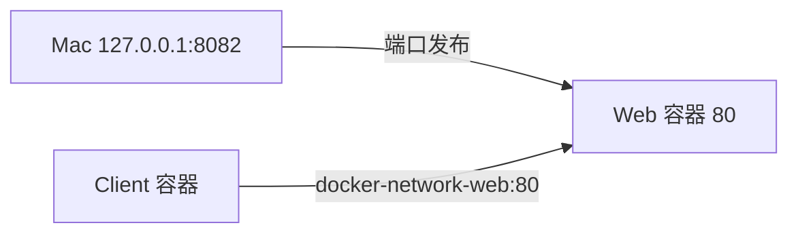

# 04 Docker 网络与容器通信

这是 Docker 学习的第四阶段：先弄清不同位置的 `localhost`，再用自定义网络、容器名称和端口发布建立可预测的通信路径。Docker Compose 留到下一阶段。

> [!info] 验证状态
> 2026-11-01 已对照 Docker 官方文档核验网络、名称解析和端口发布规则，并完成命令静态检查。当前 Docker CLI 为 29.8.1、context 为 `desktop-linux`，但 Engine 未运行，因此本页实验尚未实际启动；执行前先确认 Docker Desktop Engine 已启动。

## 一句话结论

同一自定义网络中的容器用“容器名 + 容器端口”通信；Mac 要访问容器时使用“宿主机地址 + 已发布的宿主机端口”；容器内的 `localhost` 永远先指向该容器自己。

## 1. 容器为什么需要单独的网络

如果两个程序都运行在 Mac 上，它们可以使用 Mac 的地址和端口互相访问。容器则有自己的网络环境：它看到自己的网卡、IP、路由和 `localhost`，不会自动把另一个容器或 Mac 当成自己。

> [!note] 新名词
> **网络命名空间（Network Namespace）**：Linux 为一组进程提供的独立网络视图。不同容器通常拥有各自的网卡、IP、路由和 `localhost`。
>
> **网络接口（Network Interface）**：操作系统收发网络数据的接口。容器通常能看到自己的 `eth0` 和本地回环接口，而不是直接看到 Mac 的全部网卡。
>
> **端口（Port）**：一台主机或容器内用于区分网络服务的编号。例如 Nginx 默认在容器的 TCP 80 端口等待请求。

因此，“应用监听了 80 端口”还不够完整，必须继续问：这个 80 属于哪个容器或哪台主机？请求从哪里发起？两端是否处在同一个网络？

## 2. 先区分四种访问方向

| 发起位置 | 访问目标 | 应使用的地址 | 是否需要端口发布 |
| --- | --- | --- | --- |
| 一个容器 | 同一自定义网络中的另一个容器 | `容器名:容器端口` | 不需要 |
| Mac | 容器 | `127.0.0.1:宿主机端口` | 需要 `--publish` |
| 容器 | 同一个容器中的服务 | `127.0.0.1:容器端口` | 不需要 |
| Docker Desktop 中的容器 | Mac 上运行的服务 | `host.docker.internal:宿主机端口` | 不使用容器的 `--publish` |

最常见的错误是把这些地址混在一起。例如 Web 容器使用 `localhost:5432` 访问数据库时，它实际寻找的是 Web 容器自身的 5432 端口，而不是数据库容器。

## 3. 默认 bridge 与自定义网络

Docker Engine 启动后会提供默认 `bridge` 网络。没有写 `--network` 的普通容器会连接到这里，但默认 bridge 上的容器不能直接通过容器名互相解析。学习多容器通信时，应创建用户自定义 bridge 网络。

> [!note] 新名词
> **网络驱动（Network Driver）**：Docker 实现某种网络行为的组件。`bridge` 用于同一 Docker Engine 上的容器通信，是本阶段的重点。
>
> **Bridge（网桥）**：连接同一台 Docker 主机内多个容器的虚拟网络。可以把它理解为只存在于 Docker 环境中的虚拟交换设备。
>
> **Docker DNS**：Docker 为用户自定义网络提供的名称解析服务。它把容器名或网络别名解析为当前容器 IP，因此应用不必硬编码 IP。

| 对比 | 默认 `bridge` | 用户自定义 bridge |
| --- | --- | --- |
| 如何加入 | 未写 `--network` 时自动加入 | 运行时明确写 `--network NETWORK` |
| 能否按容器名访问 | 默认不能 | 可以 |
| 能否按项目隔离 | 不方便 | 可以为每个项目创建独立网络 |
| 当前阶段建议 | 了解其存在 | 多容器实验优先使用 |

查看当前网络：

```bash
docker network ls
```

创建名为 `docker-learning-net` 的自定义 bridge 网络：

```bash
docker network create --driver bridge docker-learning-net
```

`--driver bridge` 指定网络驱动；此处即使省略，Docker 也会默认创建 bridge 网络。查看它的详细信息：

```bash
docker network inspect docker-learning-net
```

结果中可以看到驱动、地址范围、网关以及已经连接的容器。内部 IP 由 Docker 分配，实验中只观察它，不把它写进应用配置。

## 4. 容器名通信与端口发布是两条不同路径

下面的图同时表示两条请求路径。上方是 Mac 通过已发布端口访问 Web 容器；下方是 Client 容器在自定义网络内直接用 Web 容器名称访问。



第一条箭头从 Mac 的 8082 端口进入 Docker Desktop，再转发到 Web 容器的 80 端口。第二条箭头完全发生在 `docker-learning-net` 内部：Docker DNS 先把 `docker-network-web` 解析为当前容器地址，Client 随后直接请求 Web 容器的 80 端口。内部通信不需要绕到 Mac 的 8082 端口，也不要求 Web 端口先发布。

> [!note] 新名词
> **端口发布（Port Publishing）**：在宿主机建立一个入口，把到达宿主机端口的流量转发给容器端口。命令参数是 `HOST_IP:HOST_PORT:CONTAINER_PORT`。
>
> **NAT（Network Address Translation）**：在不同网络地址之间改写并转发流量的机制。默认 bridge 网络的端口发布通常由 Docker 配置相应的 NAT 与防火墙规则。

## 5. 完成一次自定义网络实验

### 5.1 确认 Engine 已运行

```bash
docker version
```

输出必须同时包含 `Client` 和 `Server`。如果只有 Client 或提示无法连接 socket，先启动 Docker Desktop 并等待 Engine 进入 Running 状态。

### 5.2 创建网络

```bash
docker network create --driver bridge docker-learning-net
```

预期输出是一串网络 ID。重复创建同名网络会提示已经存在；可以先用 `docker network inspect docker-learning-net` 判断它是否为本实验之前创建的网络。

### 5.3 启动 Web 容器

```bash
docker run --name docker-network-web \
  --detach \
  --network docker-learning-net \
  --publish 127.0.0.1:8082:80 \
  nginx:1.31.6-alpine
```

这条命令同时完成四件事：创建名为 `docker-network-web` 的容器、后台启动 Nginx、把它连接到自定义网络、把 Mac 本地 8082 端口转发到容器 80 端口。

### 5.4 从另一个容器按名称访问

```bash
docker run --rm \
  --network docker-learning-net \
  alpine:3.23 \
  wget -qO- http://docker-network-web
```

这次会临时创建一个 Alpine 容器。它和 Web 容器加入同一网络，因此 Docker DNS 能解析 `docker-network-web`；URL 没写端口时，HTTP 默认使用 80。预期输出包含 Nginx 欢迎页的 HTML。命令结束后，`--rm` 会删除这个临时 Client 容器。

这里没有使用 `127.0.0.1:8082`，因为那是给 Mac 使用的入口。两个容器之间直接走自定义网络。

### 5.5 从 Mac 访问已发布端口

```bash
curl http://127.0.0.1:8082
```

预期同样返回 Nginx 欢迎页。查看端口映射：

```bash
docker port docker-network-web
```

预期包含类似 `80/tcp -> 127.0.0.1:8082` 的结果。左侧是容器端口，右侧是 Mac 上的访问入口。

### 5.6 检查网络成员

```bash
docker network inspect docker-learning-net
```

此时 `Containers` 部分应包含 `docker-network-web`。临时 Alpine 容器已经退出并自动删除，因此不应继续出现在网络成员中。

## 6. 三个容易混淆的 `localhost`

`localhost` 和 `127.0.0.1` 都表示“当前网络环境中的自己”，但“自己”取决于命令在哪里运行。

| 命令运行位置 | `localhost` 指向 | 能否直接表示 Web 容器 |
| --- | --- | --- |
| Mac 终端或浏览器 | Mac | 只有发布端口后，才能通过 Mac 端口进入容器 |
| `docker-network-web` 容器内 | Web 容器自己 | 可以访问该容器自身监听的服务 |
| 临时 Alpine Client 容器内 | Alpine 容器自己 | 不能；应使用 `docker-network-web` |

如果容器要访问 Mac 上启动的开发服务，Docker Desktop 提供特殊名称 `host.docker.internal`。例如 Mac 上有服务监听 8000，容器内可尝试访问：

```text
http://host.docker.internal:8000
```

`host.docker.internal` 是 Docker Desktop 提供的宿主机入口，不是其他容器的通用名称。原生 Linux Docker Engine 不保证默认提供它；需要时可在运行容器时明确添加 `--add-host host.docker.internal:host-gateway`，并在实际 Linux 环境验证。

## 7. `EXPOSE` 不等于发布端口

Dockerfile 中可以写：

```dockerfile
EXPOSE 80
```

它表示“这个镜像中的应用预计监听 80 端口”，方便阅读者和工具理解镜像，但不会自动开放 Mac 的 80 或 8082 端口。真正建立宿主机入口的是运行容器时的：

```bash
--publish 127.0.0.1:8082:80
```

参数从左到右分别表示：

| 部分 | 含义 |
| --- | --- |
| `127.0.0.1` | 只在当前 Mac 本机地址上监听 |
| 第一个 `8082` | Mac 上接收请求的宿主机端口 |
| `80` | Nginx 在容器内监听的端口 |

如果只写 `--publish 8082:80`，Docker 默认可能绑定宿主机的所有网络接口，使同一网络中的其他设备也有机会访问。学习和本地开发时，明确写 `127.0.0.1` 更容易控制访问范围。

同一自定义网络中的容器访问 `docker-network-web:80` 时不需要 `--publish`，也不依赖 Dockerfile 是否写了 `EXPOSE 80`；只要目标进程确实在容器的可达地址和端口监听即可。

## 8. 如何选择地址

| 你的目标 | 使用方式 |
| --- | --- |
| Mac 浏览器访问 Web 容器 | `127.0.0.1:已发布的宿主机端口` |
| Web 容器访问同一网络的数据库容器 | `数据库容器名:数据库容器端口` |
| 容器访问自己内部的辅助进程 | `127.0.0.1:该进程端口` |
| Docker Desktop 容器访问 Mac 服务 | `host.docker.internal:Mac服务端口` |

不要把 `docker inspect` 看到的动态容器 IP 固定写入应用配置。容器重建后 IP 可能变化，而同一自定义网络中的容器名可以继续作为访问入口。下一阶段学习 Compose 时，这个原则会变成“使用 Compose 服务名通信”。

## 9. 精确清理本实验资源

先停止并删除 Web 容器：

```bash
docker stop docker-network-web
docker rm docker-network-web
```

容器删除后，再删除本实验创建的网络：

```bash
docker network rm docker-learning-net
```

`docker network rm` 在仍有容器连接时会拒绝删除，因此应先检查网络成员并处理本实验容器。不要使用 `docker network prune` 或 `docker system prune` 代替上述命令，它们可能删除其他项目的未使用资源。

本实验没有创建 Volume，也不需要删除 `nginx:1.31.6-alpine` 或 `alpine:3.23` 镜像；它们可能仍被其他学习实验使用。

## 10. 来源

以下资料均于 2026-11-01 访问：

- [Networking overview](https://docs.docker.com/engine/network/) — 默认 bridge、自定义网络、名称通信和网络驱动。
- [Port publishing and mapping](https://docs.docker.com/engine/network/port-publishing/) — 端口映射、默认绑定范围和 `127.0.0.1` 限制。
- [Docker Desktop networking how-tos](https://docs.docker.com/desktop/features/networking/networking-how-tos/) — `host.docker.internal`、Desktop 端口转发和平台边界。
- [Dockerfile reference: EXPOSE](https://docs.docker.com/reference/dockerfile/#expose) — `EXPOSE` 只声明端口，不自动发布。
- [docker network](https://docs.docker.com/reference/cli/docker/network/) — 网络的创建、查看、连接与删除命令。

## 相关

- [[Docker网络]] — 自定义 bridge、名称解析和端口发布的规范说明
- [[Docker架构]] — CLI、Daemon 与 Docker Desktop 的职责边界
- [[Docker镜像与容器]] — 容器身份和运行时资源
- [[03-Docker数据存储]] — 与网络并列的运行时数据资源
- [[Docker学习路径]] — 下一阶段将学习 Docker Compose
